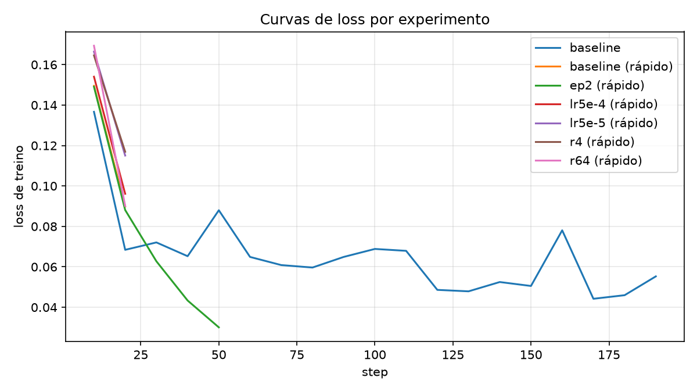
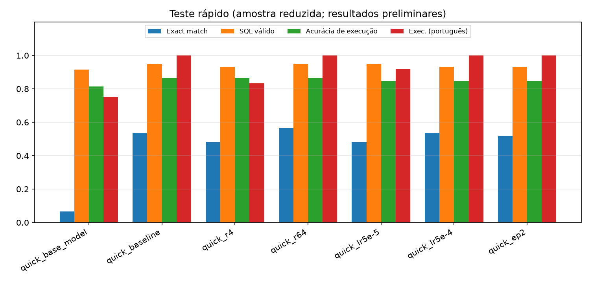
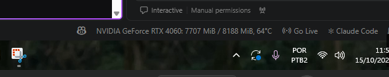
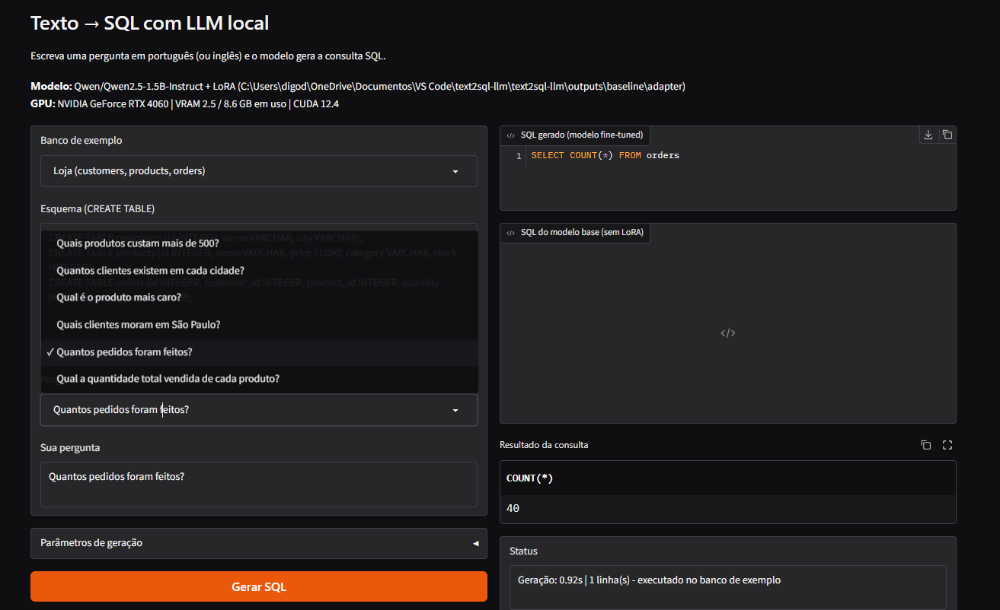

# Texto → SQL com LLM local (QLoRA em GPU)

Trabalho de IA — FIAP. Fine-tuning de uma LLM **local** para transformar perguntas em linguagem natural
(português ou inglês) em consultas **SQL**, com avaliação automática, testes de parâmetros, uso de **GPU**
e um **frontend** web.

## Integrantes

| Nome | RM |
| :--- | :--- |
| Rodrigo Fernandes Serafim | 550816 |
| Henrique de Brito Costa | 98831 |

```
Pergunta (PT/EN) + esquema (CREATE TABLE)  ──►  LLM + adaptador LoRA  ──►  SQL  ──►  resultado no SQLite
```

## 1. Problema

Pessoas sem conhecimento de SQL precisam consultar bancos de dados. O modelo recebe o **esquema das tabelas** e a
**pergunta** e devolve apenas a consulta SQL (dialeto SQLite). O esquema vai junto no prompt para que o modelo use
os nomes reais de tabelas e colunas em vez de inventá-los.

## 2. Modelo e método

| Item | Escolha |
|---|---|
| Modelo base | `Qwen/Qwen2.5-1.5B-Instruct` (multilíngue, bom em português, cabe em GPUs de 6–8 GB) |
| Técnica | **QLoRA**: base em 4 bits (bitsandbytes) + adaptadores LoRA (PEFT) em todas as projeções lineares |
| Treino | Loss só nos tokens da resposta (o prompt é mascarado), `Trainer` do Hugging Face, otimizador `paged_adamw_8bit` |
| Dataset | [`b-mc2/sql-create-context`](https://huggingface.co/datasets/b-mc2/sql-create-context) (inglês) + exemplos em **português** escritos pelo grupo (`data/pt_br_train.jsonl`) |
| Frontend | Gradio (`app/app.py`) |

**Por que um modelo pequeno?** O trabalho exige treinar localmente na GPU de cada integrante. Um modelo de 1,5 bilhão
de parâmetros pode ser treinado com QLoRA em uma GPU de 8 GB; no ambiente testado, o baseline levou cerca de 23 minutos.
Para trocar de modelo,
use `--model` (ex.: `Qwen/Qwen2.5-0.5B-Instruct` para GPUs menores, `Qwen/Qwen2.5-3B-Instruct` se houver VRAM).

## 3. Estrutura do repositório

```
├── README.md
├── requirements.txt
├── src/
│   ├── config.py        # TrainConfig / GenConfig e caminhos
│   ├── prompts.py       # montagem do prompt e limpeza da saída
│   ├── data.py          # dataset, exemplos PT, tokenização com máscara de loss
│   ├── modeling.py      # carregamento do modelo (4 bits) e checagem de GPU
│   ├── train.py         # fine-tuning QLoRA
│   ├── inference.py     # geração (modelo base ou com adaptador)
│   ├── sqlutils.py      # normalização, SQLite com dados fictícios, execution match
│   ├── evaluate.py      # métricas
│   ├── experiments.py   # varredura de parâmetros (treino e inferência)
│   ├── sample_dbs.py    # bancos de exemplo do frontend
│   └── gpu.py
├── app/app.py           # frontend Gradio
├── notebooks/treino_text2sql.ipynb
├── scripts/             # check_gpu.py, plot_results.py, build_pt_seed.py
├── data/                # pt_br_train.jsonl, pt_br_eval.jsonl
├── results/             # métricas, previsões e logs (versionados)
└── docs/                # GPU_CUDA.md, RELATORIO.md, img/
```

## 4. Instalação

Requisitos: Python 3.10+, GPU NVIDIA e driver atualizado. **Leia `docs/GPU_CUDA.md`** (versão correta do CUDA).

```bash
python -m venv .venv
.venv\Scripts\activate            # Windows  (Linux/macOS: source .venv/bin/activate)

# 1) PyTorch com a versão de CUDA da sua placa (escolha em https://pytorch.org/get-started/locally/)
pip install torch --index-url https://download.pytorch.org/whl/cu124

# 2) Demais dependências
pip install -r requirements.txt

# 3) Confirme que a GPU está funcionando (tire o print aqui, no VSCode)
python scripts/check_gpu.py
```

## 5. Como usar

Tudo é executado na raiz do projeto.

```bash
# Treinar (baseline: r=16, lr=2e-4, 1 época, 3000 exemplos)
python -m src.train --run-name baseline

# Avaliar: modelo base (antes) e fine-tuned (depois)
python -m src.evaluate --name base_model --n 200 --pt
python -m src.evaluate --name baseline --adapter outputs/baseline/adapter --n 200 --pt

# Testar parâmetros (teste rápido primeiro, depois a varredura completa)
python -m src.experiments --mode all --quick
python -m src.experiments --mode all

# Gráficos e tabela para o relatório
python scripts/plot_results.py

# Frontend
python app/app.py
```

Ou execute tudo pelo notebook `notebooks/treino_text2sql.ipynb`.

**Sem VRAM suficiente?** `--batch-size 2 --grad-accum 8`, `--max-length 384` ou um modelo menor (`--model Qwen/Qwen2.5-0.5B-Instruct`).
**`bitsandbytes` não funciona no seu Windows?** Use `--no-use-4bit` (LoRA em fp16/bf16; usa mais VRAM).

## 6. Avaliação

Conjunto de avaliação **fixo** (200 exemplos do dataset que nunca entram no treino) + 12 exemplos em português com
**esquemas inéditos** (`data/pt_br_eval.jsonl`). Métricas:

| Métrica | O que mede |
|---|---|
| **Exact match** | SQL idêntico ao de referência (após normalizar espaços e caixa) — rigorosa demais, pois SQL equivalente pode ser escrito de formas diferentes |
| **SQL válido** | A consulta executa sem erro no SQLite |
| **Acurácia de execução** | O resultado é igual ao da referência em bancos SQLite com **dados fictícios** gerados a partir do esquema (2 sementes diferentes). É a métrica principal |

## 7. Experimentos de parâmetros

Um parâmetro por vez em relação ao baseline (`r=16`, `lr=2e-4`, 1 época):

| Parâmetro | Valores testados |
|---|---|
| Rank do LoRA (`alpha = 2r`) | 4 · **16** · 64 |
| Learning rate | 5e-5 · **2e-4** · 5e-4 |
| Épocas | **1** · 2 · 3 |
| `temperature` / `top_p` | greedy · 0,3 / 0,7 / 1,0 × 0,9 / 1,0 |

### Resultados

Avaliação executada em 200 exemplos fixos em inglês e nos 12 exemplos de avaliação em português:

| Execução | Exact match EN | SQL válido EN | Exec. acc. EN | Exact match PT | SQL válido PT | Exec. acc. PT | Tempo de treino | VRAM de pico |
|---|---:|---:|---:|---:|---:|---:|---:|---:|
| base_model (sem fine-tuning) | 0,045 | 0,9495 | 0,8636 | 0,7500 | 1,0000 | 0,7500 | – | – |
| baseline (QLoRA) | 0,6900 | 0,9848 | 0,9242 | 0,9167 | 1,0000 | 0,9167 | 1.404 s | 4,4 GB |

As métricas de execução subiram 6,06 pontos percentuais em inglês e 16,67 pontos em português após o fine-tuning.
O treino usou 3.000 exemplos em inglês e repetiu 3 vezes os 42 exemplos em português (3.126 exemplos ao todo).
Os arquivos completos de métricas e previsões estão em `results/eval_*.json` e `results/preds_*.csv`.

Os testes de parâmetros abaixo foram executados em **modo rápido** (300 exemplos de treino, 60 de avaliação);
servem como verificação preliminar do pipeline, não substituem a varredura completa. O baseline experimental e o
modelo base foram comparados em 60 exemplos (59 avaliáveis em inglês; 12 em português). O teste de 3 épocas foi
interrompido por levar mais de uma hora estimada, e o sweep de inferência (temperature/top_p) não foi executado.
Não interprete os resultados rápidos como uma varredura completa.

| Execução rápida | Parâmetro variado | Exact match EN | SQL válido EN | Exec. acc. EN | Exec. acc. PT | Treino (s) | VRAM (GB) |
|---|---|---:|---:|---:|---:|---:|---:|
| base_model | sem fine-tuning | 0,0667 | 0,9153 | 0,8136 | 0,7500 | – | – |
| baseline | r=16, lr=2e-4, 1 época | 0,5333 | 0,9492 | 0,8644 | 1,0000 | 71,5 | 4,06 |
| r4 | r=4, lr=2e-4, 1 época | 0,4833 | 0,9322 | 0,8644 | 0,8333 | 83,4 | 4,88 |
| r64 | r=64, lr=2e-4, 1 época | 0,5667 | 0,9492 | 0,8644 | 1,0000 | 75,2 | 6,43 |
| lr5e-5 | r=16, lr=5e-5, 1 época | 0,4833 | 0,9492 | 0,8475 | 0,9167 | 79,6 | 6,86 |
| lr5e-4 | r=16, lr=5e-4, 1 época | 0,5333 | 0,9322 | 0,8475 | 1,0000 | 98,8 | 7,80 |
| ep2 | r=16, lr=2e-4, 2 épocas | 0,5167 | 0,9322 | 0,8475 | 1,0000 | 293,4 | 8,73 |

Para essas execuções, a acurácia em inglês usa 59 exemplos avaliáveis e a acurácia em português usa 12 exemplos.
A linha `baseline` acima é o teste rápido, distinto do baseline principal (3.126 exemplos) apresentado na avaliação.
`results/experiments.md` contém a tabela completa das execuções rápidas disponíveis; `results/experiments_quick.csv`
é a fonte dos dados. Ela não representa a varredura completa planejada acima.




## 8. Prints exigidos

As capturas de GPU e frontend estão em `docs/img/`.





## 9. Limitações

- A acurácia de execução usa dados fictícios: consultas diferentes podem coincidir por acaso (e raramente o contrário).
- Esquemas grandes (muitas tabelas) e JOINs complexos continuam difíceis para um modelo de 1,5B.
- Os exemplos em português são poucos (42 de treino); aumentar esse conjunto é o maior ganho esperado.
- O frontend só executa `SELECT` (uma instrução) em bancos em memória.

## 10. Checklist do trabalho

| Requisito | Onde |
|---|---|
| Escolher a LLM | Seção 2 (`Qwen2.5-1.5B-Instruct`) |
| Problema específico | Texto → SQL |
| Testar diferentes parâmetros | `src/experiments.py`, seção 7 |
| Avaliar as respostas | `src/evaluate.py`, `results/` |
| Testes em GPU | `src/train.py` exige CUDA; `scripts/check_gpu.py` |
| Frontend para o prompt | `app/app.py` |
| Print da GPU no VSCode | `docs/img/uso_gpu.png` |
| Código e documentação no GitHub | este repositório + `docs/` |
