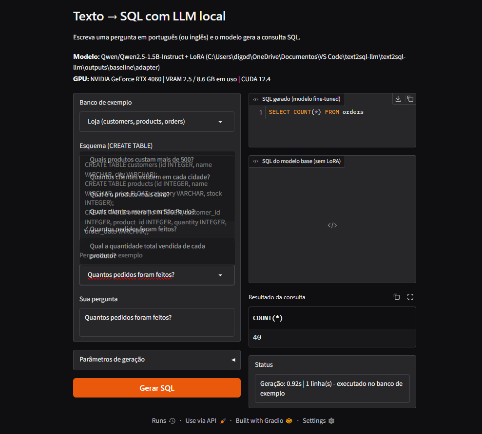

# Relatório — Texto → SQL com LLM local

**Disciplina:** Trabalho de IA — FIAP  
**Data:** 15/10/2026  
**Integrante informado no README:** Rodrigo — RM 550816

## 1. Introdução e problema

O projeto transforma perguntas em linguagem natural em consultas SQL para pessoas que precisam consultar dados sem
escrever SQL manualmente. A aplicação recebe o esquema das tabelas junto com a pergunta para reduzir erros de
identificação de tabelas e colunas. As consultas são geradas para SQLite e podem ser executadas em bancos de exemplo.

## 2. Escolha da LLM

| Modelo | Parâmetros | Decisão |
|---|---:|---|
| Qwen2.5-1.5B-Instruct | 1,5 B | Escolhido: multilíngue e compatível com QLoRA na RTX 4060 de 8 GB testada |
| Qwen2.5-0.5B-Instruct | 0,5 B | Não testado |
| Qwen2.5-3B-Instruct | 3 B | Não testado; maior necessidade de VRAM |

## 3. Dados

- Dataset principal: `b-mc2/sql-create-context`, com pergunta, esquema `CREATE TABLE` e SQL de referência.
- A avaliação em inglês usa 200 exemplos de uma divisão fixa criada após shuffle com seed 42. A primeira faixa de
  1.000 exemplos fica reservada à avaliação; o treino usa exemplos a partir dessa faixa.
- O conjunto em português possui 42 exemplos de treino (repetidos 3 vezes no baseline) e 12 exemplos de avaliação
  com esquemas inéditos. O script `scripts/build_pt_seed.py` valida o SQL executando-o em SQLite.
- O baseline treinou com 3.000 exemplos em inglês e 126 instâncias dos exemplos portugueses: 3.126 exemplos ao todo.

## 4. Método e hardware

- Fine-tuning QLoRA: modelo base quantizado em 4 bits (NF4), adaptadores LoRA nas projeções
  `q_proj`, `k_proj`, `v_proj`, `o_proj`, `gate_proj`, `up_proj` e `down_proj`.
- Rank `r=16`, `alpha=32`, learning rate `2e-4`, uma época, batch size 4 e acumulação de gradiente 4.
- O prompt inclui o esquema e a pergunta; a loss é calculada apenas nos tokens da resposta SQL.
- **GPU:** NVIDIA GeForce RTX 4060, 8 GB de memória dedicada.
- **Driver:** 596.49 (nvidia-smi reportou suporte até CUDA 13.2).
- **PyTorch:** 2.6.0+cu124; runtime CUDA 12.4; BF16 suportado.
- O treino baseline levou 1.404 s (23 min 24 s), com loss médio 0,0647 e pico de memória alocada pelo PyTorch de 4,4 GB.

## 5. Avaliação e resultados do baseline

Exact match compara a consulta normalizada; SQL válido mede se a consulta executa; acurácia de execução compara os
resultados em dois bancos SQLite com dados fictícios. Para inglês, 198 dos 200 exemplos foram avaliáveis; para
português, os 12 foram avaliáveis.

| Modelo | Idioma | Exact match | SQL válido | Acurácia de execução |
|---|---|---:|---:|---:|
| Base, sem fine-tuning | Inglês (n=200; 198 avaliáveis) | 0,0450 | 0,9495 | 0,8636 |
| Baseline QLoRA | Inglês (n=200; 198 avaliáveis) | 0,6900 | 0,9848 | 0,9242 |
| Base, sem fine-tuning | Português (n=12) | 0,7500 | 1,0000 | 0,7500 |
| Baseline QLoRA | Português (n=12) | 0,9167 | 1,0000 | 0,9167 |

O fine-tuning elevou a acurácia de execução em 6,06 pontos percentuais no conjunto inglês e 16,67 pontos no português.
Os resultados detalhados e as previsões estão em `results/eval_base_model*.json`, `results/eval_baseline*.json`,
`results/preds_base_model*.csv` e `results/preds_baseline*.csv`.

### Exemplos de erro do baseline (inglês)

| Pergunta (resumida) | Problema observado |
|---|---|
| Concorrente com menos votos | Ordenação em sentido contrário (`DESC` em vez de menor contagem) e coluna/tabela de origem inconsistente |
| Estados com faculdades abaixo do maior enrollment | O modelo omitiu `DISTINCT`, alterando duplicatas do resultado |
| “What is the position of tickets sold/available…” | Projetou uma coluna em vez de contar as ocorrências |
| “What is the number of bonus points…” | Usou `COUNT(bonus_points)` em vez de retornar o valor da coluna |
| “Show names for artists without any exhibition” | Reescreveu a anti-junção como `EXCEPT`; a diferença de duplicatas causou resultado distinto |
| Datas de início e término de pesquisadores | Substituiu as linhas por `MIN`/`MAX` e alterou o filtro textual |
| “What i/o buses…” | Produziu identificador de coluna malformado (`brand_name__list_[0]`), tornando o SQL inválido |

As previsões completas, inclusive as consultas de referência, ficam em `results/preds_baseline.csv`.

## 6. Testes de parâmetros

A varredura rápida usa 300 exemplos de treino e 60 de avaliação (59 avaliáveis em inglês), portanto seus resultados
são preliminares. O teste de 3 épocas foi interrompido por levar mais de uma hora estimada; os testes de inferência
temperature/top_p e a varredura completa não foram executados.

| Execução rápida | Parâmetro | Exact match EN | SQL válido EN | Exec. acc. EN | Exec. acc. PT | Tempo (s) | VRAM (GB) |
|---|---|---:|---:|---:|---:|---:|---:|
| base_model | Sem fine-tuning | 0,0667 | 0,9153 | 0,8136 | 0,7500 | – | – |
| baseline | r=16, lr=2e-4, 1 época | 0,5333 | 0,9492 | 0,8644 | 1,0000 | 71,5 | 4,06 |
| r4 | r=4, lr=2e-4, 1 época | 0,4833 | 0,9322 | 0,8644 | 0,8333 | 83,4 | 4,88 |
| r64 | r=64, lr=2e-4, 1 época | 0,5667 | 0,9492 | 0,8644 | 1,0000 | 75,2 | 6,43 |
| lr5e-5 | r=16, lr=5e-5, 1 época | 0,4833 | 0,9492 | 0,8475 | 0,9167 | 79,6 | 6,86 |
| lr5e-4 | r=16, lr=5e-4, 1 época | 0,5333 | 0,9322 | 0,8475 | 1,0000 | 98,8 | 7,80 |
| ep2 | r=16, lr=2e-4, 2 épocas | 0,5167 | 0,9322 | 0,8475 | 1,0000 | 293,4 | 8,73 |

O arquivo `results/experiments.md` apresenta a tabela completa; os gráficos de loss e comparação ficam em
`docs/img/loss_curves.png` e `docs/img/experiments.png`.

## 7. Análise

No baseline avaliado, o fine-tuning melhorou exact match, validade e acurácia de execução em inglês. Em português,
houve ganho de acurácia de execução de 0,75 para 0,9167; como o teste contém apenas 12 exemplos, essa estimativa é
limitada. A execução sobre dados fictícios também pode fazer consultas diferentes coincidirem por acaso, portanto
deve ser interpretada junto com exact match e inspeção manual das previsões.

Na pequena amostra da varredura rápida, `r64` teve o maior exact match em inglês (0,5667), enquanto a acurácia de
execução em inglês ficou empatada em 0,8644 para r=4, r=16 e r=64. Não é evidência suficiente para escolher uma
configuração vencedora: a comparação usa apenas 59 exemplos avaliáveis. O valor de 8,73 GB reportado pelo processo
ep2 excede os 8 GB de memória dedicada anunciados para a GPU, pois o pico medido inclui a métrica de memória CUDA
do processo/driver e não deve ser lido como VRAM dedicada exclusivamente.

## 8. Frontend

O Gradio permite selecionar quatro bancos de exemplo ou informar um esquema próprio, escolher uma pergunta de exemplo,
ajustar temperature/top-p/limite de tokens, gerar SQL, executar consultas somente leitura e opcionalmente comparar
com o modelo base. A captura demonstra a pergunta “Quantos pedidos foram feitos?” e o resultado de 40 linhas.

## 9. Limitações e próximos passos

- Os resultados de execução usam dados fictícios; consultas diferentes podem produzir resultados iguais por coincidência.
- O modelo pequeno ainda pode errar JOINs, agregações, filtros, duplicatas e nomes de colunas, especialmente em esquemas
  complexos.
- A avaliação em português tem somente 12 exemplos; ampliar e diversificar o conjunto é um próximo passo importante.
- O frontend executa somente uma instrução `SELECT`/`WITH` em bancos em memória.
- A captura do VS Code documenta o GPU Monitor com o nome da RTX 4060, memória ocupada/total e temperatura.

## 10. Divisão de tarefas

| Integrante | Responsabilidade registrada |
|---|---|
| Rodrigo — RM 550816 | Implementação e execução do baseline, avaliação, frontend e documentação |

## Referências

- Dettmers et al., *QLoRA: Efficient Finetuning of Quantized Large Language Models* (2023).
- Hu et al., *LoRA: Low-Rank Adaptation of Large Language Models* (2021).
- Dataset `b-mc2/sql-create-context`; Qwen2.5; Hugging Face Transformers e PEFT.
